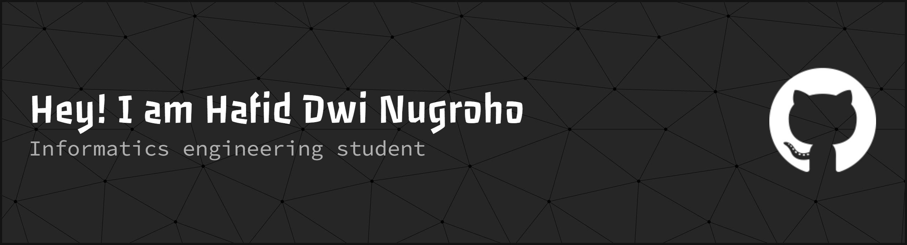

### Hi 👋! My name is Hafid Dwi Nugroho

#### 🌐 Socials:

    
  

###

###

###

#### 💻 Tech Stack:

  
  
  
  
  
  
  
  
  
  
  
  
  
  
  
  
  
  
  
  
  
  
  
  
  
  
  
  
  
  
  

###

#### 📊 GitHub Stats:

 

#### ✍️ Random Dev Quote

###

<picture data-importer="pacman">
  <source media="(prefers-color-scheme: dark)" srcset="https://raw.githubusercontent.com/hafidd12/hafidd12/pacman-output/pacman-contribution-graph-dark.svg?game=pacman">
  <source media="(prefers-color-scheme: light)" srcset="https://raw.githubusercontent.com/hafidd12/hafidd12/pacman-output/pacman-contribution-graph.svg?game=pacman">
  
</picture>

###

###
